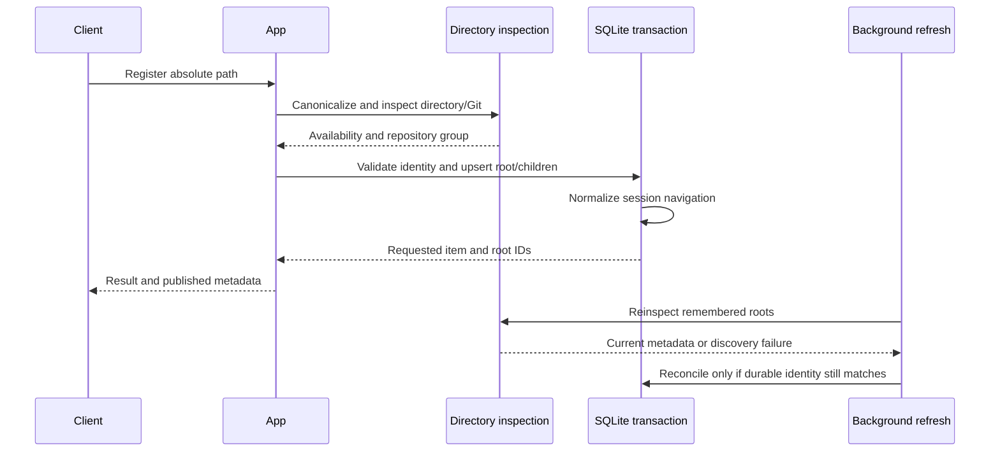

# Directory catalog

[Overview](../overview.md) / [Capabilities](overview.md) / Directory catalog

Topic 2 of 4

[Parent: Capabilities](overview.md) |
[Previous: Work and navigation](work-and-navigation.md) |
[Next: Terminal workspaces](terminal-workspaces.md)

Coding is a catalog of existing filesystem work, not a Git worktree manager.
Registration turns a directory into stable workspace-local items. Discovery then
refreshes branch and availability metadata while preserving item IDs, terminal
surfaces, and last-known repository identity when inspection fails.

## Registration and identity

A client resolves a relative or home-relative path before sending it to the
daemon; the daemon's working directory may be unrelated to the caller.
`prepareRegistration` canonicalizes the absolute directory, checks readability and
searchability, and inspects it outside the mutation transaction. Concurrent
inspection requests for the same canonical path share one in-flight operation.

For a non-Git directory, registration creates or reuses a directory root by path.
For a Git checkout, inspection reads `git worktree list --porcelain -z` and the
canonical Git common directory. Registration normalizes the group to the primary
checkout: the primary is the directory root, linked checkouts become worktree
children, and the result identifies the checkout the caller actually requested.
Registering a linked checkout can therefore return a child of a newly created
primary root.

Uniqueness is workspace-local. A canonical checkout path may not belong to two
Coding items in one workspace, and one canonical Git common directory may not
belong to two directory roots there. The same repository can be registered in a
different workspace, producing different items and surfaces. Re-registration of
an archived entry is rejected until explicitly restored.

The inspector clears Git environment variables that could redirect discovery,
uses `--no-optional-locks`, parses NUL-delimited records, and bounds subprocess
output and time. It does not run checkout, branch mutation, worktree add, remove,
or prune. Bare repositories without a primary checkout and conflicting path or
repository identities are rejected rather than guessed.

## Refresh preserves ownership

The daemon starts one refresh pass immediately, then schedules the next five
seconds after each pass completes. It scans unarchived directory roots in order.
If the primary cannot supply a trustworthy group, it can inspect remembered,
unarchived children and accept a group only when its primary path and common
metadata directory match the stored root identity.

Before applying an asynchronous result, discovery checks that the root still
exists, remains unarchived, and has the same durable path/common-directory
identity. Reconciliation and navigation normalization happen transactionally;
only a meaningful change advances the published metadata revision.

New linked checkouts receive new child items. Missing children become unavailable;
they are not deleted. Archived children are not silently revived. A failed Git
scan retains previous branch/repository metadata with a discovery error. A moved
symlink target or repository identity conflict requires explicit resolution;
discovery does not move existing runtime ownership to a new path.

Registration itself does not create a shell. The TUI follows successful creation
with activation/opening under the captured navigation context; CLI callers can
register and open as separate commands. New Coding surfaces and tabs use the
item's stored path, and callers cannot override it. Existing surfaces do not
spawn replacements merely because directory availability changes.

## Investigate

[directories.ts](../../packages/server/src/application/directories.ts) owns
canonicalization, Git inspection, parsing, and process limits.
[directory-discovery.ts](../../packages/server/src/application/directory-discovery.ts)
owns inspection lifetime, refresh scheduling, identity rechecks, and shutdown.
[items.ts](../../packages/server/src/application/items.ts), particularly
`registerDirectory`, `isTrustedGroupScan`, and `reconcileDirectoryScan`, owns
workspace-local group identity and retention of unavailable entries.

[Parent: Capabilities](overview.md) |
[Previous: Work and navigation](work-and-navigation.md) |
[Next: Terminal workspaces](terminal-workspaces.md)
