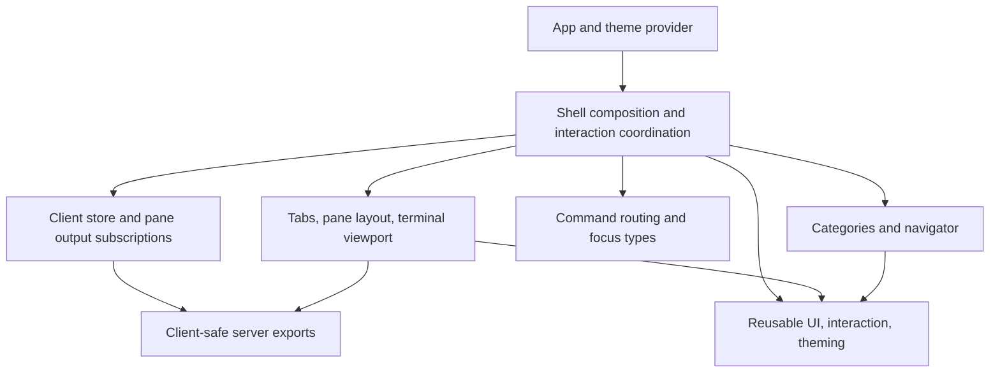

# Terminal interface

[Overview](../overview.md) / [Capabilities](overview.md) / Terminal interface

Topic 4 of 4

[Parent: Capabilities](overview.md) | [Previous: Terminal workspaces](terminal-workspaces.md)

The TUI is a disposable projection of daemon state composed by `WorkCraftShell`.
The shell joins navigation, terminal workbench, client store, command routing,
and reusable UI. Capability modules do not import the shell, and reusable UI does
not know about Work Craft's work/session model. This makes focus and interaction
coordination explicit without moving process ownership into React.

## Composition and import boundaries

The diagram summarizes responsibility direction, not every allowed import.
[The TUI import rules](../../packages/tui/.oxlintrc.json) enforce the key boundaries:
production TUI uses `@/` internal aliases and only client-safe server exports;
`client`, `input`, `navigation`, and `workbench` cannot import `shell`; reusable
`ui` cannot import application capabilities or demos. Production cannot import
tests/support. Tests live with their capability owner, while package-wide
acceptance and genuinely shared helpers live in `src/tests`.

## Shared context, local interaction

The client store owns connection state, acknowledged attachment, control snapshot,
geometry, and per-pane output buffers. React reads it with `useSyncExternalStore`.
The shell derives active work from that snapshot and attachment. Local reducer
state owns focus region, navigator query/cursor/expansion/width, dialog and prompt
values, and operational errors. The native focused renderable and current store
are consulted at input time because React closures may lag a burst of keys.

`command-router` maps Hyper, Ctrl, leader, and scoped plain keys to commands, and
produces status hints from the same definitions. The shell computes which commands
are currently meaningful. Handled application keys are consumed; unhandled keys
can reach the focused terminal only when current eligibility allows it. Modal
focus, leader state, disconnected operation, and undersized windows affect
routing before terminal input is admitted.

Create/open/split commands have two outcomes: durable state may commit, and local
focus may later move to the resulting control or pane. `use-shell-commands`
tracks operation identity, while terminal-entry coordination waits for the right
context, measured layout, control, and terminal readiness. Later input or context
changes can cancel a deferred focus handoff without undoing committed work.

## Layout changes authority

At widths below 80 columns the interface blocks ordinary interaction. From 80 to
119 columns an open navigator is a drawer; at 120 and above it can dock beside
the workbench. The shell reports a workbench canvas only while connected, suitably
sized, and unobstructed by a drawer or dialog. Hiding/covering the terminal therefore
withdraws the client's eligibility for geometry and input; it does not resize a
shell to the overlay's area.

The one-row status bar stays outside application overlays. `DialogOverlay` sets
`overlayMargins={{ bottom: 1 }}` while the reusable dialog component retains its
general defaults. Terminal panes reserve their border and any recovery notice;
too-small panes cannot admit child input. A smaller observing client clips and
follows the daemon cursor within the authoritative terminal picture instead of
inventing a second child size.

On reconnect or session attachment transition, the shell can retain the previous
presentation. That picture does not grant input authority. Current acknowledged
attachment, store scope, viewport, and terminal presentation still gate input.
See [client coordination](../foundations/client-coordination.md) and
[terminal display](../foundations/terminal-display.md) before changing these guards.

## Investigate

[main.tsx](../../packages/tui/src/main.tsx) configures the renderer and registers
the terminal material renderable. [shell.tsx](../../packages/tui/src/shell/shell.tsx)
composes the interface and viewport reports.
[use-shell-focus.ts](../../packages/tui/src/shell/use-shell-focus.ts),
[use-terminal-entry.ts](../../packages/tui/src/shell/use-terminal-entry.ts), and
[commands.ts](../../packages/tui/src/shell/commands.ts) own interaction handoffs.
[terminal-pane.tsx](../../packages/tui/src/workbench/terminal-pane.tsx) joins process
state and display readiness. Reusable controls, focus management, theming, and
primitives live under [ui](../../packages/tui/src/ui).

[Parent: Capabilities](overview.md) | [Previous: Terminal workspaces](terminal-workspaces.md)
