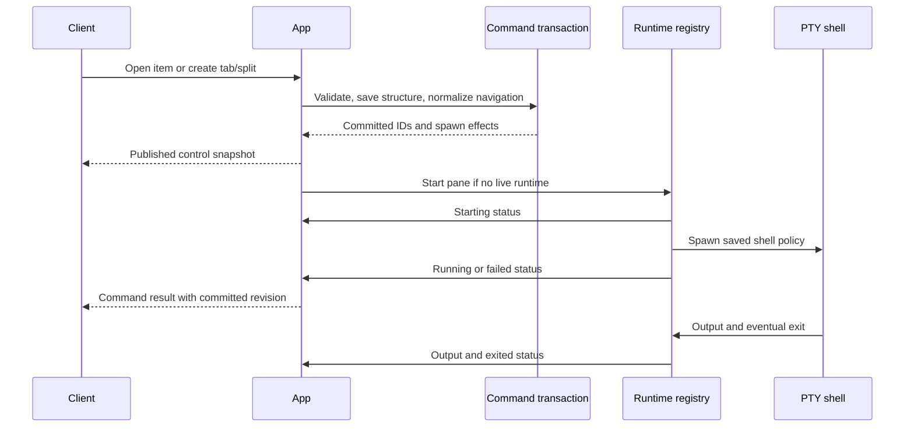

# Terminal workspaces

[Overview](../overview.md) / [Capabilities](overview.md) / Terminal workspaces

Topic 3 of 4

[Previous: Directory catalog](directory-catalog.md) | [Next: Terminal interface](terminal-interface.md)

An item's terminal workspace is durable structure around daemon-owned shell
processes. Opening creates structure once; reconnecting displays it again.
Exited or failed shells require explicit restart, and starting a process happens
after the database transaction, so a spawn failure cannot erase committed work.

## From item to running shell

`ensureSurface` returns an existing surface or creates a surface, Main tab, and
shell pane together. The tab layout initially contains that pane as one leaf.
`session.openItem` combines this with shared navigation, while `surface.ensure`
can create the structure without selecting it. New tabs add another pane under
the same surface. Splitting replaces one leaf with a binary split and recalculates
direction-aware ratios without reordering panes.

Status notifications and later snapshots can follow a committed revision before
the command response arrives. The TUI coordinates activation against IDs and
context instead of treating response order as focus authority. The CLI reads
current pane status for commands that produce a pane and reports failed startup
as an error.

## Working directory rules

Coding panes start in the item's registered path, and new surfaces/tabs reject an
override for those items. A generic item's surface can receive an explicit cwd;
otherwise it uses the daemon's cwd. The CLI resolves explicit paths in its own
process before sending them. Merely reconnecting does not update a pane's saved
cwd to whatever its shell last visited. An explicit cwd on initial surface creation
affects that first pane; it does not become an item-wide default. Later generic
tabs use the daemon cwd; tab creation has no cwd override.

A split has a different rule: by default it samples the current cwd of the source
pane's owned shell process. Linux reads `/proc/<pid>/cwd`; macOS uses bounded
`lsof` output with strict parsing. This intentionally follows the owned process,
not an arbitrary foreground descendant. The registry validates the directory and
rejects a result if the runtime was replaced/exited during inspection. An explicit
split cwd goes through directory validation instead. The new pane copies the
source pane's saved restore policy.

## Process status and restart

A pane stores executable/arguments, cwd, status, and error/timestamps. New shell
policies capture `SHELL` (falling back to `/bin/sh`) with no arguments; startup
inherits the daemon environment with `TERM=xterm-256color`. `RuntimeRegistry`
prevents overlapping starts and increments a daemon-local generation on each
new runtime, invalidating output and requests from the previous instance.

Normal exit waits for final PTY bytes, captures the last picture, destroys its
live parser, and marks the pane exited. Output remains readable. Restart starts
only a non-live pane; it appends a visible restart separator and restores retained
display before starting a new shell. It does not resurrect the old editor or
program memory. The TUI Reactivate action and pane restart shortcut add local
in-flight protection; the runtime registry remains the process authority.
The inline Reactivate action is offered for exited panes. The `leader+r` shortcut
can restart a focused exited, failed, or interrupted pane when command routing
permits it. A failed pane therefore has a shortcut restart path without the inline
Reactivate action.

Stopping the daemon terminates owned process trees, escalates to kill for
survivors, and preserves saved statuses so previously live panes can recover on
next startup. Closing a TUI only closes its connection. Archiving work and
removing a workspace from a session also leave its shells running.
[Daemon state](../foundations/daemon-state.md) owns service shutdown;
[terminal history](../foundations/terminal-history.md) owns cold recovery semantics.

## Investigate

[commands.ts](../../packages/server/src/application/commands.ts) owns surface/tab
creation and split transactions; [app.ts](../../packages/server/src/application/app.ts)
performs async cwd preparation, publishes committed changes, and applies spawn
effects. [runtime.ts](../../packages/server/src/terminal/runtime.ts) owns PTYs,
generations, input drain, and process-tree shutdown.
[restore.ts](../../packages/server/src/terminal/restore.ts) validates shell startup,
and [cwd.ts](../../packages/server/src/terminal/cwd.ts) owns platform cwd inspection.

[Previous: Directory catalog](directory-catalog.md) | [Next: Terminal interface](terminal-interface.md)
