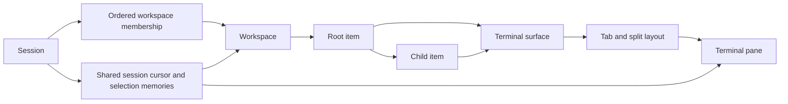

# Work and navigation

[Overview](../overview.md) / [Capabilities](overview.md) / Work and navigation

Topic 1 of 4

[Parent: Capabilities](overview.md) | [Next: Directory catalog](directory-catalog.md)

Sessions share selection; workspaces share work. A session owns its ordered
workspace memberships and one durable cursor through workspace, category, item,
tab, and pane. A workspace owns the actual items and their terminal surfaces.
Attaching two clients to one session therefore shares navigation without sharing
local focus or search drafts.

## The durable work graph

The two arrows to Surface mean either a root or child can own its own surface;
each item has at most one. A pane belongs to a surface and appears as a leaf of a
tab's saved split tree. Session selection memories remember a tab per surface and
a pane per tab, so returning to an item can restore that session's previous place.

Workspace creation adds membership in the creating session. The API/CLI can add or
remove existing workspace membership, rename/reorder/delete sessions, archive or
restore items, and select an exact navigation target. Deleting a session cascades
its membership, cursor, and selection memories; it does not delete workspaces or
stop their shells. The TUI exposes a smaller set through the session chooser,
workspace creation, category rail, navigator, tab bar, and pane actions.

## Items and category behavior

Categories are fixed in code and projected for every workspace: Inbox, Today,
Design, Implementation, Collaboration, and Operations. README calls Implementation
Coding; it is stored as `implementation` and represented by a code icon in the
TUI rail. Outside Coding, generic items may have a
single child level and arbitrary object data. A child must share its root's
workspace/category. Coding accepts registered directory roots and discovered
worktree children, not generic items. These constraints are validated when reading
persisted items as well as when executing commands.

Archival hides work from active navigation without deleting its surface, layout,
or retained output. Archiving a root also removes its children from eligible
navigation through ancestry checks; it does not rewrite each child's archive flag.
No archive command stops a runtime. The backend accepts archival for items in
general; the TUI's archive affordance is currently restricted to unavailable
Coding entries. Restoration is available through the command interface.

## Selection is a transaction, focus is a client effect

`session.navigate` selects an existing target by resolving its full ancestry in
the session. It does not create a terminal workspace. `session.openItem` ensures
that workspace exists before selecting the item; stepping between items also
ensures the selected item's surface. This distinction matters when a navigator
cursor highlights an item that has never been opened.

[applyCommand](../../packages/server/src/application/commands.ts) takes the catalog
before mutation, validates expected navigation generations when supplied, performs
the mutation, normalizes all session cursors, and applies any requested exact-pane
activation in one synchronous SQLite transaction. Normalization retains a valid
selection or finds a neighboring survivor using previous ordering, rather than
leaving a cursor pointing at archived or detached work. Explicit invalid targets
are rejected instead of silently repaired.

A session cursor's generation increments when its active context changes. Saved
selection memory can change without changing that generation. The application
revision tracks published metadata changes within a daemon lifetime; these are
different identities, explained in
[client coordination](../foundations/client-coordination.md).

The TUI derives active work from the authoritative cursor. Its navigator cursor,
filter, expanded roots, tab cursor, focus, and create-dialog draft are local
presentation state. A highlighted search result is not automatically the shared
active item. Create dialogs capture their originating scope. The completion path
checks current context before closing a dialog or moving focus, so a delayed
response does not pull the user into unrelated work.

## Investigate

- [navigation.ts](../../packages/server/src/application/navigation.ts): selection,
  remembered tabs/panes, initialization, stepping, and normalization.
- [navigation-store.ts](../../packages/server/src/application/navigation-store.ts):
  persistence and transaction-level cursor reconciliation.
- [items.ts](../../packages/server/src/application/items.ts): payload/ancestry checks
  and archival behavior.
- [shell model](../../packages/tui/src/shell/model.ts) and
  [shell state](../../packages/tui/src/shell/state.ts): shared active context versus
  local browsing state.
- [CLI arguments](../../packages/cli/src/args.ts): the current automation surface.

[Parent: Capabilities](overview.md) | [Next: Directory catalog](directory-catalog.md)
