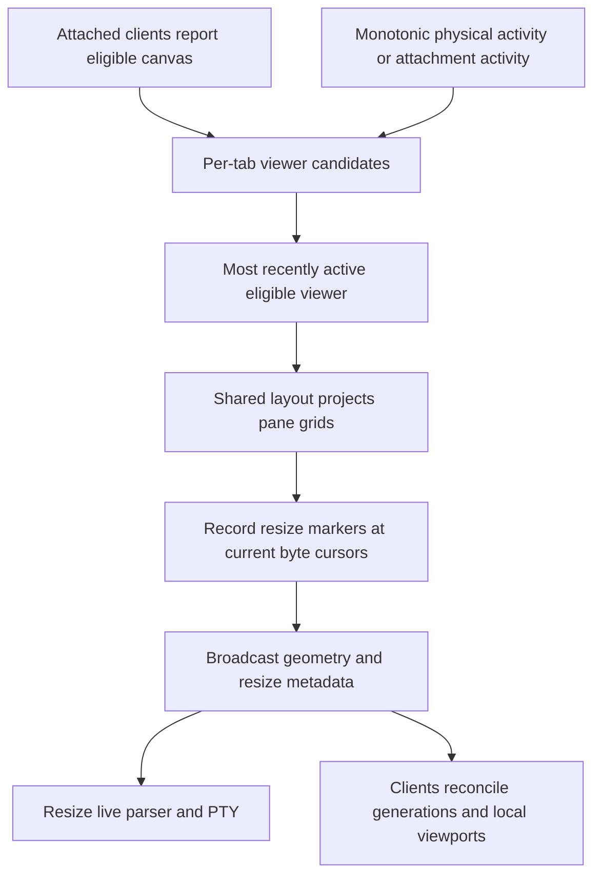

# Client coordination

Architecture tour · **6 of 7** · Previous: [Terminal display](terminal-display.md) · Next: [Terminal interface](terminal-interface.md)

Clients synchronize a daemon-owned catalog while holding only temporary authority
to interact with a selected session. Durable session navigation, socket attachment,
runtime identity and geometry each have different lifetimes. The server checks the
current combination before accepting input or returning material; reconnecting
does not replay old physical input.

## Transport and state planes

HTTP runs over the private Unix socket. `/command` executes commands, `/health`
reports daemon identity/protocol, `/control` returns metadata and runtime generations,
`/snapshot` additionally includes all retained terminal histories, and the per-pane
history route supports cursor reads. `/stream` is a WebSocket carrying snapshots,
output/status/geometry notifications and correlated interactive requests.

The TUI uses the control stream to avoid repeatedly copying all histories with
every metadata change. It obtains pane history separately, with at most four
recovery reads active at once. Material requests are another stream interaction;
their frames are not part of durable catalog snapshots. The CLI uses HTTP commands
and snapshots rather than attaching a live viewer.

The exact protocol identity is `work-craft-projection-preview/1`. Startup health
checks and the stream handshake reject a daemon with a different identity. Catalog
snapshots have a daemon epoch and revision; geometry and terminal bytes have their
own sequences because ordinary output and resize events need not change the catalog
revision.

| Identity | What it distinguishes |
| --- | --- |
| Daemon `epoch` | One application lifetime; resets across daemon starts |
| Catalog `revision` | Published structural or status change within the epoch |
| Attachment generation | One connection's acknowledged session attachment |
| Navigation generation | A session's selected workspace/item/tab/pane context |
| Tab geometry generation | Current shared grid and viewer ownership |
| Pane runtime generation | One shell/parser incarnation within the daemon |
| Output cursor and grid marker sequence | Byte continuity and retained resize order |

## Attachment is separate from selection

A new socket receives a `client.ready` identity and starts explicitly detached.
`client.attach` acknowledges a session or `null`; switching session increments the
attachment generation and withdraws viewport/paste state. The TUI uses `attachment:
null` while an acknowledgment is pending, distinct from an acknowledged attachment
whose `sessionId` is null. It automatically chooses the only session on initial
connection, otherwise leaves session choice to the UI.

Interactive commands carry attachment generation; navigation/activation commands
can additionally constrain the selected session and navigation generation. The
application rechecks socket origin after asynchronous preparation. Session deletion
reconciles attached sockets to detached state and increments their generation.
HTTP commands used by the CLI are explicit daemon operations and do not require a
viewer attachment; interactive stamps are not a separate user-authentication system.

Terminal material and semantic input carry epoch, attachment generation, navigation
generation, geometry generation and runtime generation. Material can address panes
within the selected tab, including stopped panes. Running input additionally requires
the selected pane, an eligible viewport, valid unarchived item ancestry and current
workspace membership. Geometry ownership alone does not authorize a pane.

For example, client A begins a paste into pane P, then client B changes their shared
session to another item. P's old navigation generation no longer matches. The server
clears obsolete paste assembly and rejects its old commit, even if P's shell remains
alive. The queued client sender also becomes invalid; it cannot redirect that paste
into the newly selected pane.

## One grid, many viewports

The sizing registry is in memory. Viewers need a canvas of at least 60×6 and at least
one live pane with a 20×5 terminal area after its top border. Activity elects the
latest eligible viewer per tab; focus notifications do not themselves count as
physical key/mouse/paste activity. Other clients may still type into the current
shared pane when eligible. If no viewer remains, owner becomes null and previous
grid dimensions are retained rather than shrinking the process to zero.

Geometry changes record history markers and broadcast metadata before applying PTY
resizes, keeping following output tied to the new geometry sequence. Runtime-start
sizing can use an eligible report for the starting pane or fall back to retained
in-memory dimensions/80×24. Sizing ownership is recalculated after disconnection,
navigation changes and structural changes.

Physical input may itself elect a new geometry owner. The server rechecks current
authority after that synchronous election. A mouse event is dropped if the election
changed its pane dimensions, because its coordinates were captured in the old grid.
Raw `source:response` messages are owner-filtered by the connection registry, but
the application's raw-input callback only writes `source:input`: live child replies
come from the daemon parser, as described in [terminal display](terminal-display.md).

## Gaps, reconnects and overload

Transport serializes snapshot application. A revision gap fetches the appropriate
HTTP snapshot; oversized inline snapshots become availability notices followed by an
HTTP fetch. Equal revisions are meaningful on reconnect because output may have
advanced independently. The store also sequences work and ignores callbacks from
obsolete connection/store runs.

Output cursors detect missing byte intervals. A missing history or runtime identity
change schedules pane history recovery; late history responses must match epoch,
pane, runtime and current recovery identity before merging buffered live chunks.
Geometry gaps fetch fresh control state; resize-marker gaps request pane history.
Recovery never guesses missing bytes or permits input through a recovering buffer.

Disconnect withdraws attachment and input authority while the shell can preserve
its last visual presentation. The TUI tries bounded reconnect delays, then tries
daemon startup and a fresh control fetch. Failure leaves it disconnected with an
error; explicit reload can establish another run. Commands require a connected,
acknowledged stream. Stream closure rejects pending correlated requests and aborts
snapshot fetches; ephemeral viewport/input messages are not replayed.

A lost command response does not mean its transaction failed. The daemon may have
committed before the connection closed. Request IDs correlate replies within one
connection; there is no durable command-result log or idempotency key across
connections. Refresh current state before retrying a creation command, which could
otherwise create a second object.

Transport, store queues and paste/input buffers have finite limits, commonly the
8 MiB stream budget; correlated request counts are capped at 128. Server backpressure
can close the socket, and store overflow triggers reload/recovery. These mechanisms
bound work and favor recovering a current view over accumulating unlimited lag;
they do not promise lossless output delivery to an arbitrarily slow client.

## Code References

- [HTTP endpoints](../packages/server/src/api/http.ts),
  [protocol identity](../packages/server/src/api/identity.ts) and
  [interactive parsing](../packages/server/src/api/interactive-protocol.ts).
- [Connection authority](../packages/server/src/api/connections.ts)
  (`context`, `validPane`, `projectionScope`, `eligible`): current-scope checks.
- [Sizing](../packages/server/src/application/sizing.ts): election and grid decisions;
  [application](../packages/server/src/application/app.ts) (`applyGeometry`) orders effects.
- [Stream transport](../packages/server/src/client/stream.ts): handshake, pending
  requests, snapshot order and disconnection.
- [TUI store](../packages/tui/src/client/store.ts): attachment, recovery identities,
  reconnect and bounded message application.
- [Terminal buffers](../packages/tui/src/client/terminal-buffer.ts): retained/live merge.

Architecture tour · **6 of 7** · Previous: [Terminal display](terminal-display.md) · Next: [Terminal interface](terminal-interface.md)
