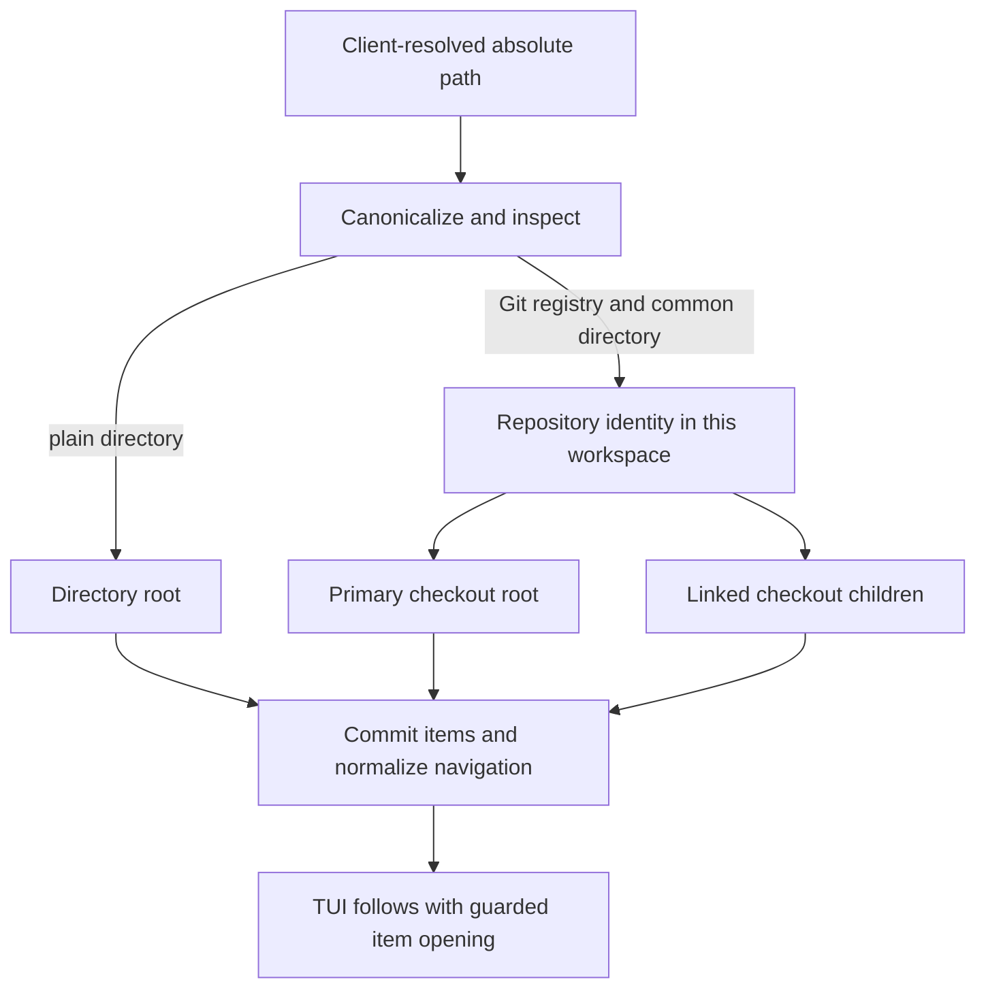

# Directory catalog

Architecture tour · **3 of 7** · Previous: [Work and navigation](work-and-navigation.md) · Next: [Terminal processes](terminal-processes.md)

Coding records existing filesystem work; it does not manage Git branches or create
or delete checkouts. Registration canonicalizes an absolute directory path, inspects
Git's worktree registry when a `.git` entry exists, and saves a workspace-local
group. Refresh updates observations while preserving item IDs, surfaces and runtime
owners.

## Register a checkout, identify its repository

Clients resolve relative paths and `~` in their own working directory before sending
them. The daemon canonicalizes the filesystem target and checks read/search access.
A plain directory becomes a directory root. A Git checkout is grouped by the
canonical common metadata directory; the primary checkout is the root and other
checkouts are worktree children. Registering a linked checkout returns that child's
ID as the requested item, alongside the primary root's ID.

The implementation reads `git worktree list --porcelain -z` and `rev-parse` with
optional locks disabled and Git location override variables removed. NUL-delimited
records preserve paths containing newlines. Git inspection shares a two-second
deadline and bounds each output stream. Bare repositories without a primary checkout
are rejected by the supported layout checks.

Registration inspects asynchronously, then validates discovery lifetime and scan
availability before the synchronous command transaction. Existing archived targets
must be restored explicitly. Repository/path conflicts fail instead of merging
owners or moving a terminal surface between items. SQLite uniqueness constraints
also prevent duplicate checkout and repository identities in the same workspace.
The same repository can be registered independently in another workspace.

## Refresh preserves last-known identity

The normal daemon starts an immediate discovery pass and schedules another five
seconds after each pass completes. Passes do not overlap, and simultaneous inspection
of one path shares a pending promise. Refresh considers unarchived directory roots,
then rechecks durable root identity after each asynchronous inspection before writing.

A previously known Git group accepts a registry only when its primary path and
remembered common-directory identity match. If the primary checkout cannot supply
a trusted scan, refresh tries remembered unarchived worktree children. This permits
a surviving linked checkout to describe the group without transferring root
ownership. Reconciliation and session-navigation normalization commit together.

Missing children become unavailable and retain their IDs and saved terminals. A
discovery error retains prior Git metadata and children instead of interpreting a
failed registry read as deletion. A directory whose canonical target has changed
becomes unavailable; it must be registered under its new identity separately.
Archival is explicit rather than an automatic response to a missing checkout.

Availability affects creating a surface or tab for a Coding item: its saved path
must be available and cannot be overridden with another cwd. An already-existing
surface remains the same resource. A later shell restart still validates the pane's
own saved cwd. Discovery never moves a live process into a different directory.

The CLI `directory register` performs registration only. The TUI directory-create
flow follows successful registration with an item-open operation, guarded by the
dialog's session/navigation context. Registration's backend support therefore does
not imply unconditional terminal activation in every client.

Shutdown closes discovery, aborts outstanding Git inspections and awaits their
completion before the database is closed; late scan results cannot write after it.

## Code References

- [Client paths](../packages/server/src/client.ts) (`resolveClientPath`): calling-client
  path resolution.
- [Inspection](../packages/server/src/application/directories.ts)
  (`canonicalDirectoryPath`, `inspectDirectory`, `parseWorktrees`): filesystem/Git
  observations and limits.
- [Discovery lifecycle](../packages/server/src/application/directory-discovery.ts):
  refresh scheduling, fallback inspection, cancellation and stale-result checks.
- [Item reconciliation](../packages/server/src/application/items.ts)
  (`registerDirectory`, `isTrustedGroupScan`, `reconcileDirectoryScan`): durable
  identity, conflict and availability rules.
- [TUI creation](../packages/tui/src/shell/commands.ts) (`submitCreate`) and
  [entry coordination](../packages/tui/src/shell/use-terminal-entry.ts): guarded
  opening of the returned item.

Architecture tour · **3 of 7** · Previous: [Work and navigation](work-and-navigation.md) · Next: [Terminal processes](terminal-processes.md)
