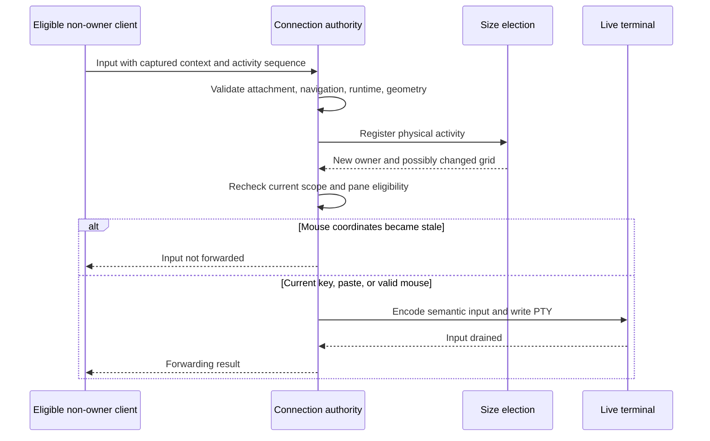

# Client coordination

[Overview](../overview.md) / [Foundations](overview.md) / Client coordination

Topic 2 of 4

[Parent: Foundations](overview.md) |
[Previous: Daemon and durable state](daemon-state.md) |
[Next: Terminal display and input](terminal-display.md)

Clients share the daemon's work state but have distinct connections and session
attachments. Terminal input is accepted only for the current attachment, shared
navigation, runtime, and tab geometry. Geometry ownership elects a terminal size;
it does not grant one client an exclusive keyboard lock.

## Transport and state channels

HTTP on the Unix socket serves health, full snapshot, control snapshot, commands,
and per-pane history. A WebSocket serves initial snapshots, metadata changes,
output, status/geometry notifications, attachments, interactive commands, material
requests, and input acknowledgments. JSON carries metadata; terminal byte fields
are base64, while material requests return compact portable cell rows.

The TUI uses a control snapshot, which omits bulk terminal histories and includes
per-pane runtime identities. Full snapshots remain available for CLI inspection
and clients that request them. Snapshots above the inline size threshold become
`control.available` or `snapshot.available`; the client stream fetches the
corresponding HTTP endpoint while preserving message ordering. Transport and
store queues have byte limits; backpressure closes or reloads a connection rather
than allowing unlimited pending data.

The client store refreshes control state on revision/geometry gaps and fetches
per-pane history for missing output. History recovery has a bounded parallel lane
and checks identity again after each asynchronous fetch. Responses for a replaced
runtime, attachment, connection, or daemon do not populate the new scope.

## Freshness is several identities

- **Epoch:** One daemon lifetime. A new epoch invalidates all old daemon context.
- **Revision:** Published metadata within that lifetime. It orders catalog
  projections without claiming to order every terminal byte.
- **Connection ID and attachment generation:** A socket and its acknowledged
  session attachment. A new attachment invalidates work captured for the old one.
- **Session navigation generation:** The session's active context. Selection
  changes invalidate old input and activation intent.
- **Runtime generation:** One pane's shell/parser incarnation. It rejects requests
  and bytes from an older runtime.
- **Geometry sequence and tab generation:** Global geometry update order and one
  tab's geometry identity. They reject stale sizing and mouse coordinates.
- **Output cursor:** The end byte offset in one pane's history. It detects duplicate
  notifications and missing byte ranges.

`InputStamp.geometrySequence` names the **per-tab generation**, despite its name.
`TerminalGeometry.sequence` orders global geometry notifications. Activity in an
unrelated tab must not invalidate an input stamp for this tab. Runtime generations
are daemon-local and need the epoch to distinguish a restarted service.

## Attachment and authorization

On connection, the server emits `client.ready` with a protocol identifier. The
client verifies it, then sends `client.attach`. Null attachment means explicitly
detached; a null local acknowledgment means attachment is pending. The TUI clears
its local acknowledgment immediately when changing sessions, so old content cannot
receive input during the handshake. If a session is deleted, the server detaches
its clients and increments attachment generation.

Interactive commands carry increasing request IDs and attachment generation.
Async commands retain a `CommandOrigin`; the app revalidates it after preparation
and verifies that navigation/activation belongs to the attached session. Expected
navigation generations can reject commands prepared against a stale cursor.
The CLI's HTTP commands have no attached TUI session and explicitly name their
targets. Attachment checks coordinate interactive state; they are not a security
boundary between local programs that can access the socket.

Terminal requests additionally verify epoch, navigation generation, per-tab
geometry generation, and runtime generation. The pane must belong to the current
tab/item/workspace/session, and neither item nor root may be archived. Material
reads permit stopped panes; input requires the selected running pane and an
eligible viewport. Client-side guards improve responsiveness, while server-side
validation is authoritative.

## Multiple viewers, one child size

Each eligible TUI reports its canvas for the shared selected tab. The most recently
active eligible connection supplies that tab's size. Attachment counts as activity;
accepted increasing activity sequences update the ordering. A report change alone
does not automatically steal ownership. Focus reports do not count as new physical
activity. A withdrawn/disconnected viewer allows another candidate to win; with no
candidate, the previous canvas and pane sizes are retained.

Eligibility requires a sufficiently large canvas and at least one viable pane.
The shared layout projector computes pane grids with one divider cell and a
reserved pane border row. `createApp.applyGeometry` records resize markers and
broadcasts geometry before resizing live PTYs. This ties later output to the
geometry under which it was produced.

An eligible non-owner can send input, and that activity may elect it as size owner
synchronously. Mouse input is dropped if that election changes the pane size,
because its original coordinates are no longer reliable. Keys/paste use the
current terminal encoder. Paste assembly is scoped and cleared when context
changes so partial content cannot arrive in a different pane.

The following case shows why current navigation and geometry must be checked
separately from a connection's ability to send a request:

## Reconnection and failure

The store retries a closed stream with bounded delays, then attempts daemon
startup/refresh and a new connection. Reconnect reattaches the desired session,
marks histories for repair, and establishes new authority. No terminal keystrokes
or unacknowledged mutating commands are automatically replayed. A command may
have committed before its response was lost; callers must inspect state before
assuming it failed or retrying a non-idempotent creation.

The shell may keep its old picture during this interval, but disconnect or pending
attachment prevents mutations/input. Output recovery repairs retained display;
it does not recreate the previous connection identity or authorize buffered keys.

## Investigate

[protocol.ts](../../packages/server/src/api/protocol.ts) defines the state/identity
contracts. [http.ts](../../packages/server/src/api/http.ts) exposes transport;
[connections.ts](../../packages/server/src/api/connections.ts) authorizes interactive
requests; [sizing.ts](../../packages/server/src/application/sizing.ts) elects geometry.
[stream.ts](../../packages/server/src/client/stream.ts) owns client transport
ordering, requests, and paste transfer;
[store.ts](../../packages/tui/src/client/store.ts) owns reconciliation and reconnect.

[Parent: Foundations](overview.md) |
[Previous: Daemon and durable state](daemon-state.md) |
[Next: Terminal display and input](terminal-display.md)
