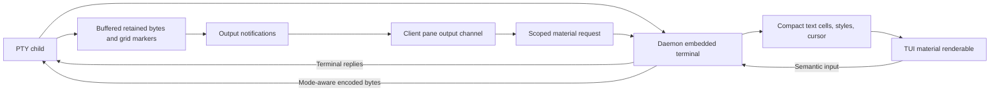

# Terminal display and input

[Overview](../overview.md) / [Foundations](overview.md) / Terminal display and input

Topic 3 of 4

[Parent: Foundations](overview.md) |
[Previous: Client coordination](client-coordination.md) |
[Next: Terminal history and recovery](terminal-history.md)

The daemon is the terminal emulator authority. Each live pane has one native
OpenTUI embedded terminal that parses PTY bytes, tracks terminal modes, answers
child queries, and encodes input. The TUI paints portable cell material requested
from that terminal; it does not parse ANSI independently for the visible pane.
This keeps mode handling authoritative across multiple clients and while no client
is attached.

## Output and material flow

`RuntimeRegistry` feeds the parser before appending and broadcasting the same
output bytes. It drains terminal-generated replies and writes them directly to
the child, including when no client is attached. Parser errors are retained and
make material/input operations fail rather than silently producing a divergent
emulator.

`createTerminalProjection` owns native context, embedded terminal, render buffer,
and leases. It resolves glyph text and copies colors/attributes while a buffer
lease is held. Native pointers and context-local glyph or link IDs never escape
into the wire protocol. Frames contain size, cursor, a shared style table, and
run-length cell rows with text and width. The codec validates geometry, grapheme
width, row shape, styles, and byte budgets on each side of the boundary.

The TUI's per-pane output subscriptions signal that a newer picture is needed
without forcing every output byte through a full React shell render. The viewport
coalesces material requests at roughly 33 ms intervals, with at most one request
and one picture awaiting presentation. A material response is accepted only for
the same stream/context and expected live grid. A smaller client clips the
canonical picture and follows its cursor rather than resizing the child on every
local layout event.

## Input waits for what was presented

Receiving a picture is not the same as presenting it. `TerminalViewport` waits for
OpenTUI's post-presentation FRAME event and verifies the exact frame was drawn.
Input captures current scope and the output version it must follow; the input
queue flushes only after the corresponding picture is presented. Scope changes
abort pending material, clear queued input, and withdraw readiness. This prevents
keys captured around an activation/resize from overtaking the visible state.

The material renderable translates outer OpenTUI events to semantic keys, mouse,
paste, and focus. `terminal-semantic-input` retains physical key/modifier/text
information, including Kitty release/repeat/associated text. The daemon's live
parser decides which child bytes these events mean under current modes. A single
semantic write waits for PTY drain before acknowledgment, with byte and timeout
bounds. New semantic input cannot overtake pending input or incomplete paste.

Large paste uses begin/chunk/commit transfer messages. The receiver validates
transfer identity, offsets, size, and the frozen authority stamp. Only complete
input affects sizing activity; partial assembly cannot invalidate its own stamp.
Navigation, geometry, runtime, attachment, or disconnect changes can cancel it.

Mouse forwarding results control local behavior. If the child consumed a mouse
event, the client does not also start selection or scrollback. If it did not,
the material renderable can select text or adjust scroll offset. Stopped panes
permit history scrolling with hidden cursor and no child input.

## Known limitations and unresolved risks

The current picture path has deliberate fidelity limits. Compact frames carry
foreground/background/attributes but omit hyperlink targets, and projection
extraction masks attributes to the low eight bits. Cursor styles are mapped to
OpenTUI's available line/underline/block presentation. A single regional indicator
is validated with the native two-cell width but remains visibly narrow in the
material renderer; the code documents that mismatch.

The daemon patches native mode 2048 capability replies to unsupported because the
native implementation advertises resize reports it does not emit. This is a
specific compatibility workaround in `replies()`, not a general terminal feature
negotiation layer. Projection/transcript resources, scrollback, frames, and pending
work are bounded; complex output may fail a budget rather than grow indefinitely.

**Unclear:** The application does not define a complete supported-terminal-feature
matrix for the native embedded terminal. The checked code demonstrates specific
projection, input, and continuation cases, but does not establish fidelity for
all terminal programs. A renderer/native upgrade needs focused compatibility
verification at the behaviors affected, especially grapheme widths, modes,
queries, and cold display extraction.

**Unclear:** A
[prior architecture record](https://github.com/console-craft/work-craft/blob/6b7279b35f75f16baf1ae651af33f7b7b1d7c604/docs/architecture/references/terminal-lifecycle.md#known-limitations-and-unresolved-risks)
reports intermittent multi-client frame differences after a cold restart and the
removal of the acceptance case that exposed them. This source-only documentation
run does not establish that the issue was repaired. Keep this specific uncertainty
separate from general terminal compatibility limits.

## Investigate

[projection.ts](../../packages/server/src/terminal/projection.ts) is the native
adapter; [runtime.ts](../../packages/server/src/terminal/runtime.ts) joins parser,
child, and input drain. [terminal-material.ts](../../packages/server/src/api/terminal-material.ts)
and [its codec](../../packages/server/src/api/terminal-material-codec.ts) define the
portable representation.
[terminal-viewport.tsx](../../packages/tui/src/workbench/terminal-viewport.tsx)
coordinates material requests/presentation;
[terminal-material.ts](../../packages/tui/src/workbench/terminal-material.ts)
paints and selects cells;
[terminal-input.ts](../../packages/tui/src/workbench/terminal-input.ts) owns queued
input admission. See [history and recovery](terminal-history.md) for the distinct
parser lifetime used when a pane is no longer running.

[Parent: Foundations](overview.md) |
[Previous: Client coordination](client-coordination.md) |
[Next: Terminal history and recovery](terminal-history.md)
