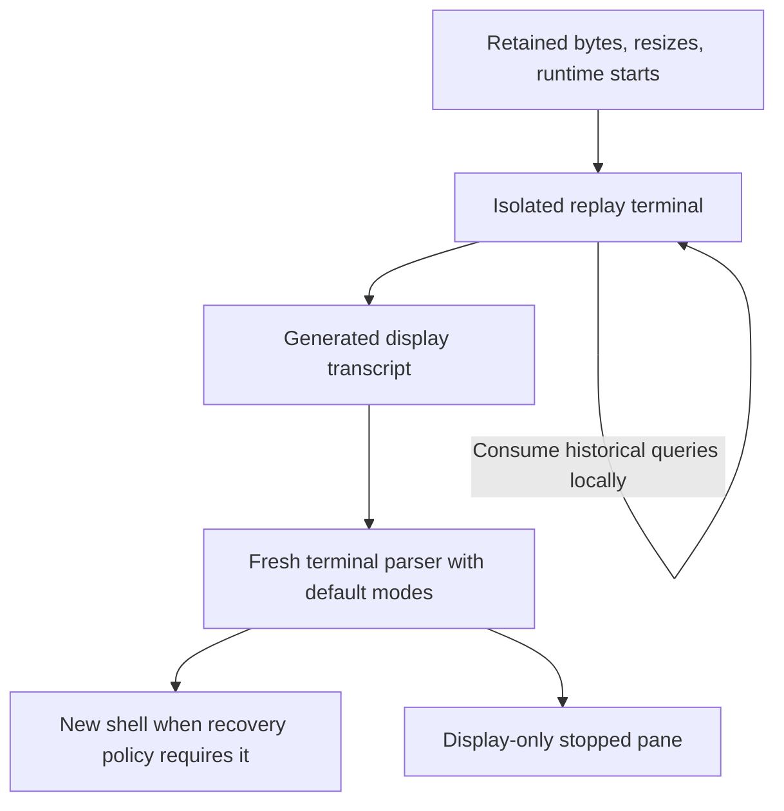

# Terminal history and recovery

[Overview](../overview.md) / [Foundations](overview.md) / Terminal history and recovery

Topic 4 of 4

[Parent: Foundations](overview.md) | [Previous: Terminal display and input](terminal-display.md)

Retained output is a bounded display history, not a process checkpoint. The daemon
stores byte ranges together with the terminal grids and runtime boundaries needed
to interpret them. Recovery uses that record to generate display-only content in
an isolated parser, then starts fresh terminal modes and, where appropriate, a
fresh shell. Historical terminal replies never reach a new child.

## Recording and retention

`TerminalHistory.append` copies PTY bytes into a per-pane queue and advances a
monotonic byte cursor. Reads combine persisted chunks and pending bytes, so a
connected client can see output before it is flushed. By default flush is scheduled
after 100 ms, or sooner after 32 KiB is queued. A flush transaction writes bytes,
trims older ranges, and commits corresponding geometry metadata.

The default retention budget is 1 MiB per pane. Retention is coordinated with
bounded grid/runtime markers, so it is not an unlimited transcript archive.
`HistoryRead` identifies its cursor range, initial grid, ordered resizes, whether
history was truncated, and any synthetic prefix bytes. Truncated reads include a
reset and visible truncation notice; prefix bytes are not counted as historical
PTY cursor positions. Clients must not treat missing earlier bytes as still
recoverable.

`HistoryGeometry` records actual grid changes at their byte cursor and records
`fresh` or `restored` runtime starts. Same-cursor markers still have ordering via
sequence. This allows replay to distinguish ordinary resize from the beginning
of another shell even though pane identity and retained bytes continue.

Graceful shutdown flushes pending history, then closes it after runtimes stop.
An abrupt crash can lose bytes still in the in-memory queue. SQLite durability
does not make every output callback immediately durable.

## Cold restoration isolates terminal modes

`restoreColdProjection` validates byte ranges, replays bytes and resizes in order,
and consumes generated replies locally. At runtime-start boundaries it extracts
visible/scrollback display, discards the old parser, creates a fresh parser, and
applies generated display commands. Final extraction also yields a new parser
with display preserved and historical modes removed. A `fresh` start boundary
keeps older output as history while preparing a new screen.

The transcript builder is bounded by native cell/scrollback and encoded-byte
budgets. It consumes its isolated parser; it does not serialize native terminal
handles, raw mode state, or arbitrary previously emitted control bytes as a live
runtime checkpoint. The restored parser can receive real new child output without
inheriting a previous application's input modes.

On daemon startup, saved `running`, `starting`, and `interrupted` panes are marked
interrupted, get a visible daemon-restart separator and restored-grid marker,
and start fresh shells at an initial 80 by 24 grid. Geometry arbitration can
resize them after clients attach. Saved exited/failed panes stay stopped. Explicit
restart also preserves history and adds its own separator; it uses the pane's
saved cwd/shell policy, not application memory from the old process.

## Stopped panes and reconnect repair

A live runtime keeps its parser. After normal process exit, it retains a last
frame for zero-offset display and releases the live parser. A scrolled stopped
pane, or one loaded after service restart, can reconstruct display from history.
This does not start a child. The cursor is hidden for stopped material.

`StoppedDisplay` shares one finite work lane between runtime history preparation
and stopped reads. It deduplicates identical reconstruction requests, caches one
display keyed by pane/runtime/cursor/grid/size, and rechecks caller freshness
before publishing. Restart invalidates the pane's cache/reads; shutdown cancels
queued work and waits for active cleanup. Obsolete reconstruction must not replace
material for a newly started runtime.

The TUI's per-pane history repair is a separate transport concern. On output gaps
or reconnect it fetches the retained byte range and merges it with notifications
that arrived during the read. Epoch/runtime/context checks prevent stale responses
from repairing the wrong incarnation. Those bytes trigger authoritative material
requests; they do not authorize local ANSI interpretation or old input replay.

## Investigate

[history.ts](../../packages/server/src/terminal/history.ts) owns byte cursors,
flush, retention, and response ranges;
[history-geometry.ts](../../packages/server/src/terminal/history-geometry.ts) owns
resize/start ordering and retention baselines.
[cold-history.ts](../../packages/server/src/terminal/cold-history.ts) and
[projection-transcript.ts](../../packages/server/src/terminal/projection-transcript.ts)
own safe display reconstruction.
[stopped-display.ts](../../packages/server/src/terminal/stopped-display.ts) owns
bounded read/cache lifetime. [app.ts](../../packages/server/src/application/app.ts)
selects recovery candidates, and
[terminal-buffer.ts](../../packages/tui/src/client/terminal-buffer.ts) merges
transport history and arriving output.

[Parent: Foundations](overview.md) | [Previous: Terminal display and input](terminal-display.md)
