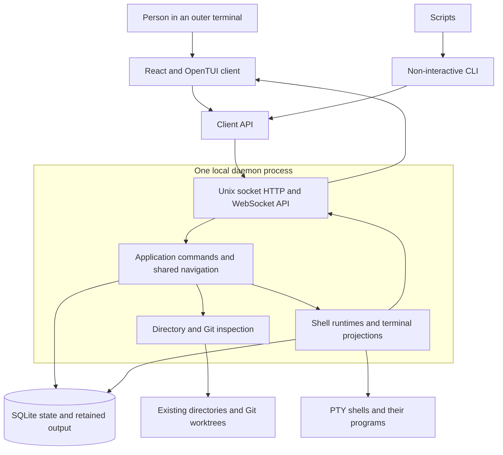

# Work Craft architecture

Work Craft is a local terminal work organizer with one background daemon per state
directory. The daemon owns saved work, session navigation, shell processes, and
terminal interpretation. The React/OpenTUI interface and non-interactive CLI are
clients of that daemon. Closing a client leaves its shells running; restarting the
daemon restores saved structure and output into fresh shells.

The most useful distinction is between **work identity**, **running processes**, and
**a client's presentation**. An item identifies work and can own a terminal workspace
(called a `surface` in code). Its tabs and pane layouts are durable. Its shell is a
daemon-owned process. Focus, filters, open dialogs, and drafts belong to the TUI and
can disappear without deleting work.

The diagram shows logical responsibilities. The API, application, discovery,
SQLite connection, and runtime registry execute inside the same daemon process.
The client API is imported into each client, not deployed as another service.

## Product concepts and ownership

- A **session** is an ordered set of workspace memberships and one shared navigation
  cursor. Two clients attached to that session follow the same workspace, category,
  item, tab, and active pane.
- A **workspace** owns items and can belong to several sessions. Membership does not
  clone its items, surfaces, or processes. Different sessions can select different
  parts of the same workspace while accessing the same underlying terminals.
- An **item** is a generic root/child outside Coding, or a registered directory and
  discovered worktree in Coding. Hierarchy is limited to roots and one child level.
- A **surface** is an item's lazily created terminal workspace. A tab contains a
  binary split tree whose leaves identify panes. Each pane has a saved shell
  restore policy and, while running, one daemon-owned pseudoterminal (PTY).

Coding is the product term used here and in README for the persisted
`implementation` category. The current category metadata title is `Implementation`,
and the TUI uses that title with a code icon. Other categories currently offer
generic items and terminals; they are not dedicated issue trackers or
collaboration integrations.

## How an interaction becomes work

Opening an item resolves its context in the session, creates its surface/tab/pane
if absent, and selects it in a SQLite transaction. Only after commit does the
application start a shell. A failed spawn leaves a real pane with a failed status
and an explicit restart path. A successful command therefore establishes durable
structure; it does not guarantee that the shell started successfully.

PTY output is interpreted in the daemon and retained as bounded bytes with resize
and runtime-start metadata. Clients receive output notifications and request
portable cell pictures to render. Input travels back as semantic key, mouse,
focus, or paste events; the daemon encodes it using the live terminal modes.
See [terminal display](foundations/terminal-display.md) for that boundary.

## Lifetimes and constraints

| State | Owner | Survives a new client? | Survives daemon restart? |
| --- | --- | --- | --- |
| Catalog, layouts, session cursors | SQLite/daemon | Yes | Yes |
| Flushed terminal bytes and grid metadata | SQLite/daemon | Yes | Yes, within retention |
| Shell/program memory and terminal modes | Live runtime | Yes | No |
| Connection, attachment, size ownership | Daemon memory | Re-established | No |
| Focus, filter, expansion, dialogs, drafts | TUI memory | No | No |

Recovery starts fresh shells for panes saved as running, starting, or interrupted;
already exited/failed panes remain stopped. Historical terminal modes and replies
are not replayed into a fresh child. Output may be lost between its arrival and
its buffered history flush during an abrupt crash.

The service listens on a local Unix socket. Filesystem permissions are the local
access boundary; there is no network authentication or remote service. Git
inspection discovers existing checkouts without creating/deleting worktrees or
changing branches. Database schema compatibility is checked, but there is no
incremental migration engine.

## Reading paths

The ordered entries below are this overview's immediate children. Each area then
has its own local sequence; use contextual links to jump to a specific concern.

### Capabilities

1. [Capabilities](capabilities/overview.md): follow work organization, repository
   discovery, terminal workspaces, and interface ownership from intent to effect.

### Foundations

2. [Foundations](foundations/overview.md): understand durable state and daemon
   lifetime, client coordination, terminal interpretation, and retained history.

### Choices

3. [Choices](choices/overview.md): assess commitments and the scope of changing
   deployment, terminal authority, or the stored work model.

### Development

4. [Development guide](development.md): find entry points, existing verification
   gates, diagnostics, and contribution guidance.

For a terminal input bug, start with
[client coordination](foundations/client-coordination.md), then
[terminal display](foundations/terminal-display.md). For missing or duplicate
repositories, start with [directory catalog](capabilities/directory-catalog.md).

## Implementation entry points

[The executable dispatcher](../src/main.ts) selects TUI, CLI, or internal daemon
mode. [createApp](../packages/server/src/application/app.ts) joins transactions,
notifications, discovery, sizing, history, and runtimes.
[The client API](../packages/server/src/client.ts) is the client-safe contract;
[the schema](../packages/server/src/persistence/database.ts) establishes durable
ownership. Details and focused source links live in the owning documents.
