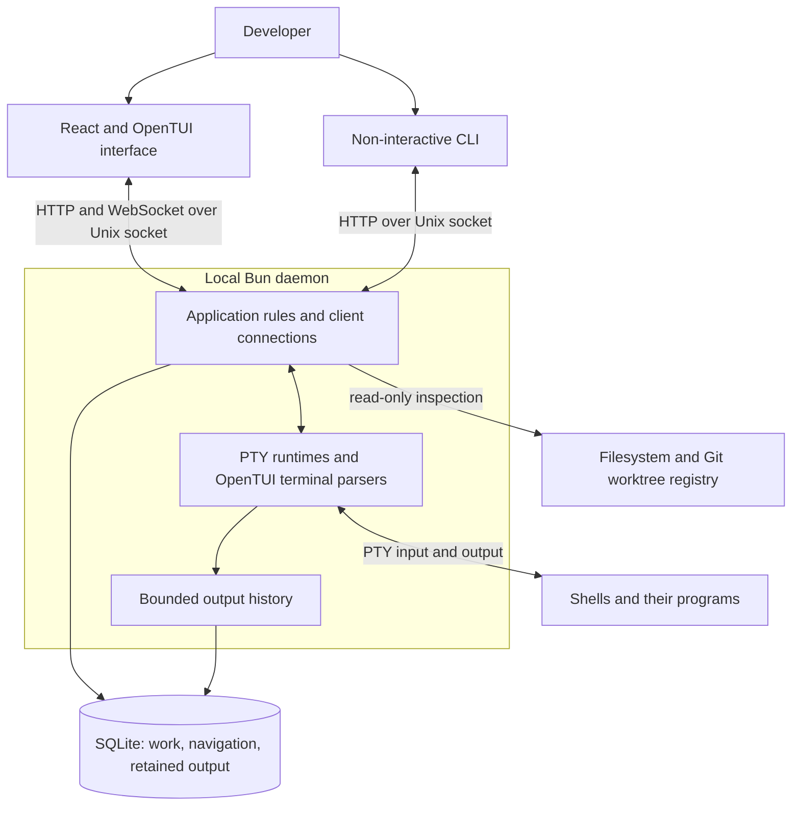

# Work Craft architecture

Architecture tour · **1 of 7** · Next: [Work and navigation](work-and-navigation.md)

Work Craft is a local work organizer whose background daemon owns saved work and
running terminals. The React/OpenTUI interface and the non-interactive CLI are
clients of that daemon. Closing an interface does not stop its shells; restarting
the daemon restores saved structure and retained display history, then starts new
shells for panes that were active. It cannot restore an editor's process memory.

A session is a shared navigation context over reusable workspaces. Workspaces own
items; each item can acquire one terminal surface containing tabs and split panes.
Clients attached to one session share its selected workspace, category, item, tab
and pane. Clients retain their own focus, browsing cursors, filters and drafts.
Different sessions can navigate the same workspace independently while still
reaching the same item surfaces and processes.

The executable dispatches to the TUI with no arguments, to the CLI for commands,
or to an internal daemon entry point. Both clients can start the daemon when it is
absent. The daemon listens on a Unix socket, rather than a network port; filesystem
permissions form the access boundary. There is no hosted service or plugin runtime.

## Key Facts

- The daemon is the sole application writer of SQLite and the owner of PTYs.
  Commands commit structural changes and shared navigation together before starting
  processes. A created pane can therefore exist even if its shell fails to start.
- A pane's saved identity survives process replacement. Daemon epochs, runtime
  generations and connection/navigation generations distinguish different lifetimes
  so delayed messages cannot borrow authority from a newer context.
- The daemon parses terminal output and encodes input according to terminal modes.
  The TUI paints portable material frames; it does not replay ANSI into a second
  live terminal emulator. Output notifications and retained history remain separate
  synchronization mechanisms.
- One eligible viewer supplies the shared tab geometry. Other clients display the
  resulting terminal grid within their local viewports. Geometry ownership does
  not give that client exclusive keyboard access.
- Output history and resize metadata are bounded. SQLite commits structural state
  synchronously, but output flushes in batches, so a crash can lose recent output.
- Coding is the user-facing name for the persisted `implementation` category.
  It registers directories and discovers worktrees. Other categories contain
  generic items, rather than specialized external-service integrations.

## Find the explanation you need

| Concern | Owning explanation |
| --- | --- |
| Saved objects, shared selection, commit ordering | [Work and navigation](work-and-navigation.md) |
| Directory identity, Git refresh, missing worktrees | [Directory catalog](directory-catalog.md) |
| Shell creation, exit, restart, daemon shutdown | [Terminal processes](terminal-processes.md) |
| ANSI parsing, material frames, scrollback restoration | [Terminal display](terminal-display.md) |
| Reconnect, stale input, attachment and resize ownership | [Client coordination](client-coordination.md) |
| UI composition, focus, keyboard commands, overlays | [Terminal interface](terminal-interface.md) |
| Local verification, boundaries, release packaging | [Development](development.md) |

## Consequential commitments

Local single-daemon ownership makes clients replaceable and keeps catalog and
navigation transactions together. Adding remote access would require a coordinated
change to transport, authorization, daemon discovery and the current filesystem
trust boundary. Moving runtime ownership into clients would be a major migration:
process persistence, display parsing and input authority all depend on the daemon.

OpenTUI is a runtime dependency of both daemon and TUI. The daemon needs its native
terminal parser even when no TUI is open. Both consumers and the React renderer are
pinned to the same core version; upgrades must preserve parser, cell extraction,
input encoding and rendering contracts. See [development](development.md).

## Code References

- [Executable dispatch](../src/main.ts) chooses the runtime entry point.
- [Application assembly](../packages/server/src/application/app.ts) (`createApp`)
  connects commands, snapshots, discovery, history, runtimes and connections.
- [Client facade](../packages/server/src/client.ts) is the client-safe contract
  used by the TUI and CLI.
- [Database schema](../packages/server/src/persistence/database.ts) defines durable
  ownership; [protocol](../packages/server/src/api/protocol.ts) defines exchanged state.

Architecture tour · **1 of 7** · Next: [Work and navigation](work-and-navigation.md)
