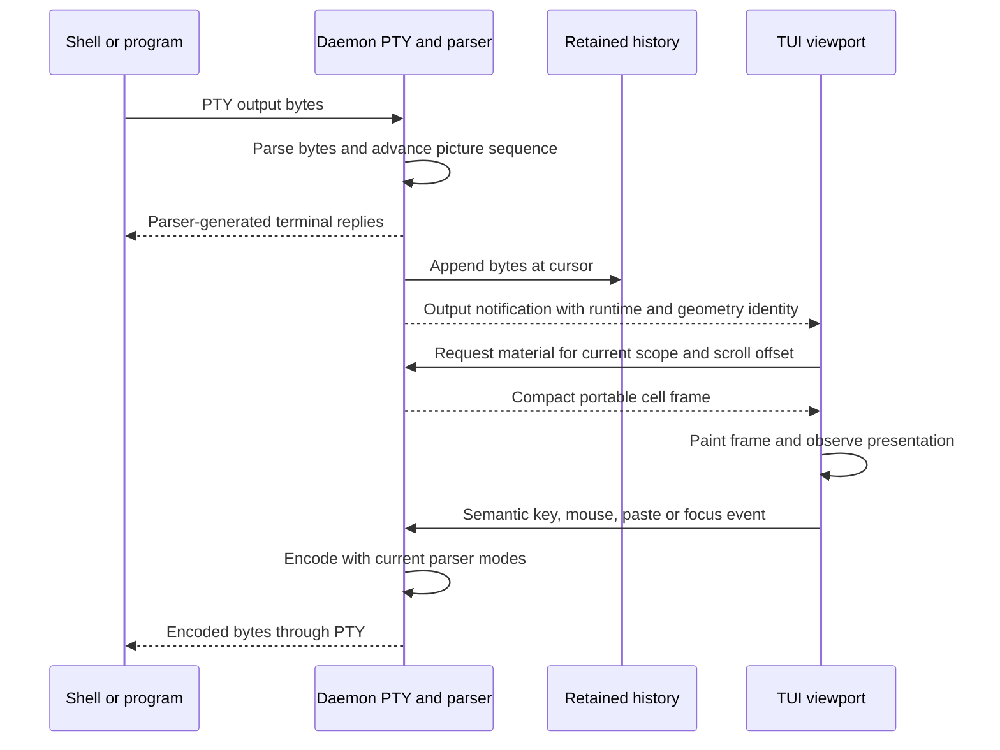

# Terminal display

Architecture tour · **5 of 7** · Previous: [Terminal processes](terminal-processes.md) · Next: [Client coordination](client-coordination.md)

The daemon owns terminal interpretation. Each live runtime has one OpenTUI native
parser that consumes PTY output, answers child queries and encodes semantic input
according to current terminal modes. Clients request portable material frames and
paint them. Reconnecting a TUI therefore cannot create a second live parser whose
query replies or mode state compete with the daemon.

## Bytes, frames and input have different roles

Output broadcasts contain bytes, cursors and identity information. The store uses
them to track continuity and trigger material refresh; the production viewport does
not feed those bytes into another ANSI parser. Full snapshots and pane history
remain useful for inspection and gap recovery. [Client coordination](client-coordination.md)
owns their ordering and resynchronization rules.

Material frames contain dimensions, resolved text, explicit cell widths, a shared
style table, run-length encoded rows and cursor information. Native glyph IDs,
buffer pointers and context-local handles never cross the socket. The server
extracts cells while holding a buffer lease, copies portable values and releases
the lease. The client validates frames before drawing them with native cell APIs.
Default terminal backgrounds follow the client theme; explicitly painted backgrounds
retain their color.

A material request temporarily scrolls the daemon parser to the requested offset
and restores its prior scroll position after extraction. One viewer's inspection
does not leave another viewer at that offset. Smaller client viewports clip the
shared grid and follow the shared cursor locally. Their measurements do not directly
resize the PTY; [geometry arbitration](client-coordination.md#one-grid-many-viewports)
decides the shared dimensions.

## Present before admitting queued input

`TerminalViewport` coalesces refresh work and spaces material requests by at least
33 ms. It allows one request and one pending presentation at a time. Output version
changes during a request schedule another read. Context changes cancel the current
request, clear queued input and reset presentation readiness. A reply from an older
stream or context cannot become the new frame.

The input queue captures its sender and authority when the physical event arrives.
It waits until the required output version has actually been rendered before sending,
rechecks admission, and processes events in order. Later focus or frames cannot
lend a fresh sender to an old queued event. The server still checks authority again;
presentation readiness is a local UI condition, not server authorization.

Keys preserve semantic identity/modifiers and associated text; mouse events carry
terminal coordinates; focus events preserve focus semantics. The daemon's parser
chooses the resulting escape encoding. Paste uses a socket-owned begin/chunk/commit
transfer with bounded bytes, exact offsets and a captured scope. No native paste
encoding occurs before an authorized complete commit. Partial paste is cleared on
scope change, disconnect, cancellation or timeout, and other input cannot overtake
it. Semantic writes await the PTY drain and allow only one in-flight semantic write
per pane.

## Stopped and restored pictures

After a live process exits, its final visible frame can be served without keeping
its parser alive. Other stopped scroll offsets, and stopped panes loaded after a
daemon restart, reconstruct a display from retained bytes and resize/start markers.
This reconstruction owns no child. It drains and discards replies from old output,
converts the result to generated display commands, then uses a fresh parser so old
input modes cannot become new live modes.

`StoppedDisplay` has one cache entry and a serialized work lane shared with runtime
history preparation. Requests with the same display identity share construction.
The key includes pane, runtime generation, history cursor, grid sequence and size;
readers recheck current scope before receiving results. Starting a pane invalidates
its stopped work. Shutdown cancels queued jobs and awaits active work before native
resources are destroyed. Stopped material hides its cursor and never grants input.

## Known limitations and unresolved risks

Display restoration is bounded by retained bytes/markers, 10,000 parser scrollback
lines, native cell budgets and an 8 MiB generated transcript limit. A large grid,
unsupported drawable cell or failed native extraction can reject material or
restoration. The viewport disables input on material failure and reports the error;
failed startup records pane status. These limits are not a guarantee that every
retained stream reconstructs successfully.

Hyperlinks are not carried in the compact frame contract, even though the broader
`MaterialCell` type has an optional link. Single regional-indicator characters remain
visibly narrow in the TUI's public drawing primitives; explicit wide continuation
cells alone do not fix native glyph rendering. The daemon also rewrites mode-2048
query replies to report unsupported behavior because native resize reports are not
emitted. These are current implementation constraints, not complete terminal
emulation coverage.

**Unclear:** Compatibility with every full-screen program and Unicode sequence is
not established by the adapter code or the selected fixtures. This matters for
claims of terminal fidelity; the repository's compatibility probe and real program
acceptance are the relevant validation path, rather than treating the portable
frame schema as proof of full emulation.

**Unclear:** A
[prior architecture record](https://github.com/console-craft/work-craft/blob/6b7279b35f75f16baf1ae651af33f7b7b1d7c604/docs/architecture/references/terminal-lifecycle.md#known-limitations-and-unresolved-risks)
reports intermittent multi-client frame differences after a cold restart and the
removal of the acceptance case that exposed them. This source-only documentation
run does not establish that the issue was repaired. Keep that specific uncertainty
separate from general terminal compatibility limits.

## Code References

- [Projection adapter](../packages/server/src/terminal/projection.ts)
  (`createTerminalProjection`): native ownership, extraction, replies and input encoding.
- [Material contract](../packages/server/src/api/terminal-material.ts) and
  [codec](../packages/server/src/api/terminal-material-codec.ts): portable frames.
- [Cold replay](../packages/server/src/terminal/cold-history.ts),
  [generated transcripts](../packages/server/src/terminal/projection-transcript.ts)
  and [stopped cache](../packages/server/src/terminal/stopped-display.ts).
- [Viewport](../packages/tui/src/workbench/terminal-viewport.tsx),
  [drawing](../packages/tui/src/workbench/terminal-material.ts) and
  [input queue](../packages/tui/src/workbench/terminal-input.ts): client presentation.
- [Paste receiver](../packages/server/src/api/terminal-paste.ts): bounded assembly.

Architecture tour · **5 of 7** · Previous: [Terminal processes](terminal-processes.md) · Next: [Client coordination](client-coordination.md)
