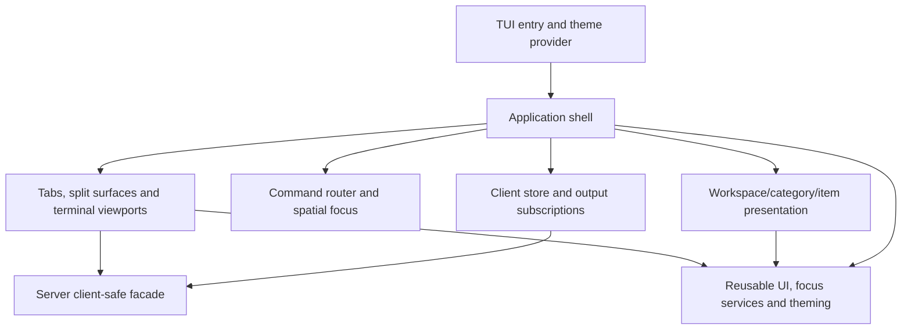

# Terminal interface

Architecture tour · **7 of 7** · Previous: [Client coordination](client-coordination.md) · Entry point: [Overview](overview.md)

The TUI is a disposable React/OpenTUI client. The shell composes navigation,
workbench, input routing and reusable UI around daemon state. It owns local focus
and interaction intent; it must not turn a visible old selection or delayed command
response into permission to type into a different terminal.

## Composition and dependency direction

`shell/` owns application composition, dialogs, local state, operational errors and
command/focus coordination. `navigation/` presents categories and filtered/expanded
item results. `workbench/` presents tabs, split geometry and terminal material;
`client/` owns connection and output state. `input/` maps keys to commands and
provides spatial focus. `ui/` owns reusable controls, primitives, interaction
services, theme types and providers. Demos exercise that reusable layer without
becoming production dependencies.

Enforced import rules keep `client`, `input`, `navigation` and `workbench` from
importing `shell`. Reusable UI cannot import application capabilities or demos.
Internal TUI imports use `@/` aliases. Production code cannot import tests or test
support. TUI code may import the server's `client` and `client/output-probe` exports,
not server internals or the server root barrel. These rules also apply to type and
dynamic imports; they make shell composition possible without reversing ownership.

## Three different kinds of state

The daemon snapshot supplies shared catalog/navigation and process status. The
client store adds ephemeral connection, acknowledged attachment, geometry and
per-pane output buffers. The shell reducer adds local focus, navigator width/open
state, filtering/expansion, browsing cursors, dialog drafts and source-specific
operational errors. Reconciliation projects shared selection into local presentation
without making a browsing cursor the authoritative session selection.

The store uses ordinary subscribers for control state and separate pane-output
subscriptions for high-frequency output. `useWorkCraft` exposes the control model
to React; terminal viewports subscribe to their pane outputs directly. A byte burst
therefore need not rerender the entire shell to request a new material frame.

During reconnect the shell can preserve its previous presentation while live
authority is absent. Seeing a terminal does not mean input is enabled. The shell
checks connection, attachment, local dialog/drawer coverage, dimensions and pane
eligibility; the store and server independently check their current contexts.

## A command completing is not enough to move focus

Commands route through declarative key bindings and current availability. Durable
commands go through the stream using the acknowledged attachment generation. The
shell's command coordinator owns submissions, error-source identity and restart
protection; terminal-entry coordination separately owns the intent to focus a
returned terminal.

Consider creating a tab while typing in an existing pane. The command captures the
source intent, then the server can publish the new selection before the response
arrives. Entry coordination waits for the exact response tab/pane IDs and a snapshot
at least as new as its committed revision, in the same epoch. It then waits for an
eligible native renderable and the relevant rendered frame before entering it.
If navigation, focus or subsequent physical input supersedes the intent, it is
cancelled. A peer's shared navigation update does not inherit another client's local
focus intent.

Native focus and reducer focus can also be separated by React commit timing.
Live refs and `getState()` let asynchronous callbacks check current state instead
of stale closures. Modal focus scopes, focus restoration and spatial movement use
native renderables as well as application targets. Restart submission protection
outlives cancellation of focus intent so cancelling entry cannot submit a duplicate
restart while the first operation is still completing.

## Layout and exposed actions

The shell reserves a one-row status bar. Application dialogs pass a bottom overlay
margin of one row so the backdrop and content do not cover or dim it; reusable
dialog defaults remain full-screen. The status bar combines contextual command hints,
connection state and operational errors. Persistent process notices belong inside
their panes rather than replacing the operational error channel.

Creation forms trim names and titles but preserve entered paths. They reject blank
values before sending a command. The daemon also rejects blank names, titles and
paths, and identifies the field in its validation error. The TUI keeps those errors
beside the field; other operational failures appear in the status bar, while child
stderr remains terminal output.

Below 80 terminal columns the resize guard blocks ordinary workbench interaction.
At 120 columns and above an open navigator docks beside the workbench; between 80
and 119 it acts as a drawer. A visible drawer or dialog withdraws the viewer report
and terminal interaction. The workbench additionally needs a 60×6 canvas, while
individual terminal content needs 20×5. Stopped-pane recovery controls can fit a
20×4 pane including their notice; display/input and restart readiness remain distinct.

The TUI creates sessions/workspaces, generic roots/children and Coding registrations,
opens items, selects tabs, creates tabs/splits and explicitly restarts stopped panes.
Session membership editing, session updates/deletion and general archive restoration
are exposed through the CLI/backend rather than equivalent TUI screens. Exact
archive and restart differences are documented in
[work and navigation](work-and-navigation.md#archive-and-client-exposure) and
[terminal processes](terminal-processes.md#starting-and-replacing-a-shell).

## Code References

- [Entry point](../packages/tui/src/main.tsx) and [App](../packages/tui/src/app.tsx):
  renderer, registered terminal primitive, React root and theme.
- [Shell](../packages/tui/src/shell/shell.tsx),
  [state](../packages/tui/src/shell/state.ts) and
  [model](../packages/tui/src/shell/model.ts): composition and local/shared projection.
- [Command routing](../packages/tui/src/input/command-router.ts),
  [commands](../packages/tui/src/shell/commands.ts) and
  [submission ownership](../packages/tui/src/shell/use-shell-commands.ts).
- [Terminal entry](../packages/tui/src/shell/use-terminal-entry.ts) and
  [entry rules](../packages/tui/src/shell/terminal-entry.ts): response, revision and
  native-frame conditions for focus transfer.
- [Shell layout](../packages/tui/src/shell/layout.ts),
  [pane layout](../packages/tui/src/workbench/layout.ts) and
  [dialog overlay](../packages/tui/src/shell/dialog-overlay.tsx).
- [Import boundary configuration](../packages/tui/.oxlintrc.json) and
  [boundary checks](../packages/tui/src/tests/boundaries.test.ts).

Architecture tour · **7 of 7** · Previous: [Client coordination](client-coordination.md) · Entry point: [Overview](overview.md)
