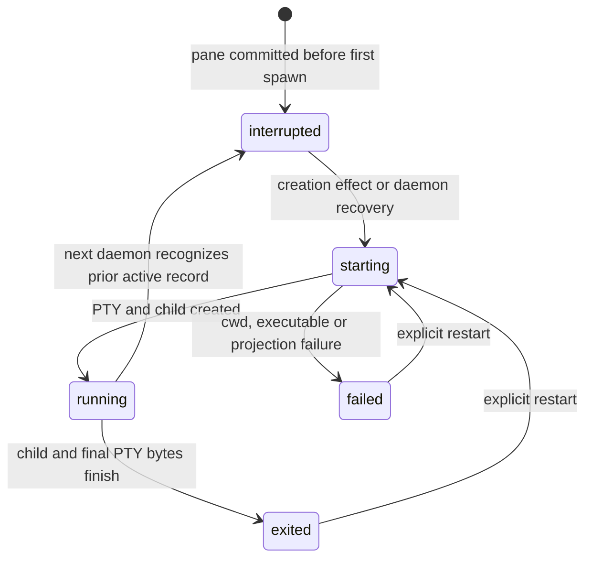

# Terminal processes

Architecture tour · **4 of 7** · Previous: [Directory catalog](directory-catalog.md) · Next: [Terminal display](terminal-display.md)

A terminal pane is durable work; its shell is a replaceable daemon-owned runtime.
Quitting or reconnecting a client leaves the runtime alive. Stopping the daemon
terminates its process trees but preserves saved structure, restore policies and
retained history. On the next normal daemon start, panes recorded as active receive
fresh shells. Panes already recorded as exited or failed stay stopped.

## Starting and replacing a shell

The first surface, a new tab and a split produce spawn effects after their catalog
transaction commits. A pane stores its initial cwd and shell executable/arguments;
new panes normally use the daemon's inherited `SHELL` or `/bin/sh`. A split copies
the source pane's restore policy. Shell startup validates the cwd and executable,
inherits the daemon environment and sets `TERM=xterm-256color`.

When no explicit split cwd is supplied, the daemon samples the cwd of its owned
shell PID, using `/proc` on Linux or bounded `lsof` output on macOS. It does not
sample a foreground editor or another descendant. It rechecks that the runtime is
still current before committing the split. An explicit CLI cwd is validated too.
Opening an existing surface does not relocate its shell. Generic surface creation
defaults to the daemon cwd when no override is provided; clients that need their
own cwd must send it explicitly.

Each start increments an in-memory runtime generation. Callbacks carry that
generation, and the application ignores output/status from an obsolete runtime.
Replacing an exited runtime waits for its final PTY bytes and parser cleanup. A
concurrent second start for the same pane is rejected. A restart request for a
currently live runtime produces no replacement because the application skips live
spawn effects.

The backend accepts `process.restart` for any existing pane; the CLI can invoke it
directly. The TUI's `leader+r` command is offered for failed, exited and interrupted
panes when a pane is selected and command routing permits it. Its inline Reactivate
button is offered only for exited panes, requires a usable recovery viewport and
current attachment, and guards repeated submissions. Material browsing of a stopped
pane does not itself restart it.

## Output durability and restoration

History appends advance a monotonic byte cursor and copy bytes into daemon memory
before broadcasting output. The default flush is 100 ms, or a scheduled immediate
flush after 32 KiB is queued. Flushes transactionally save chunks and resize metadata
in SQLite. Reads combine committed chunks with pending bytes, so an active daemon
can return output that has not yet reached disk. A crash can lose that pending tail;
the stream is not an unlimited or fully synchronous audit log.

The default retained byte budget is 1 MiB per pane and resize history is capped at
1,024 markers. Retention preserves an initial grid baseline; marker pressure can
advance retention beyond the byte-only boundary. Truncated responses include a
synthetic reset/notice prefix, whose bytes are reported separately from the logical
cursor range. Runtime-start markers distinguish fresh and restored display segments.

Normal daemon recovery first marks saved `running`, `starting` and `interrupted`
panes as interrupted, appends a restart separator and records a baseline grid. It
flushes those records before attempting fresh shell starts at an initial 80×24 grid.
The shell uses the pane's saved cwd, not the last sampled live cwd. A missing cwd or
executable produces a failed pane while other recoverable panes can continue.

Restoration reconstructs display history through isolated parsers, then initializes
a fresh live parser with generated display-only commands. Old terminal modes and
parser-generated replies must not leak into a new child. The previous program's
in-memory state, open file descriptors and jobs are not restored. The detailed
display mechanism and its bounded failure paths belong to
[terminal display](terminal-display.md).

## Daemon ownership and shutdown

Paths resolve from `WORK_CRAFT_HOME`, or from
`$XDG_STATE_HOME/work-craft` (default `~/.local/state/work-craft`). The directory
contains the SQLite database, Unix socket and daemon lock. The directory is made
private (`0700`); the lock and socket are `0600`. A PID lock, file-identity checks
and serialized stale-lock takeover prevent competing daemon owners. Startup also
checks an existing socket's health before removing a stale socket.

The database uses foreign keys, WAL and FULL synchronous mode for disk state.
`openDatabase` creates schema version 1 in an empty unversioned database. It rejects
other version numbers and nonempty unversioned databases. A version-1 database is
reopened without comparing every table definition, so a reused version number does
not establish compatibility with an older development database. There is no general
migration engine. Explicit `daemon destroy --force` uses the destroy startup mode,
which skips runtime recovery and can reset incompatible state before destruction.

Shutdown closes discovery and HTTP/WebSocket service, flushes output, cancels
pending starts, and terminates owned process trees with TERM followed by KILL for
survivors. It identifies processes using PID and observed start time. Runtime exit
callbacks are suppressed during orderly shutdown so active status remains available
for the next recovery. A final history close captures output emitted during stop.
The database closes before owned socket and lock files are removed.

Destroy removes the database and its WAL/shared-memory files only after the required
cleanup steps succeed. The CLI waits for database, lock and socket disappearance
before reporting confirmed destroy completion. Ordinary stop preserves the database.
Even status/snapshot CLI commands call `ensureDaemon`, so they may start the service;
they are not passive filesystem probes.

## Code References

- [Runtime registry](../packages/server/src/terminal/runtime.ts) (`start`,
  `currentDirectory`, `stopAll`): PTY lifecycle and process cleanup.
- [Spawn policy](../packages/server/src/terminal/restore.ts) (`resolveShellSpawn`)
  and [cwd inspection](../packages/server/src/terminal/cwd.ts).
- [Application](../packages/server/src/application/app.ts) (`recoverOnce`, `execute`,
  `onOutput`): recovery and post-commit effects.
- [History](../packages/server/src/terminal/history.ts) and
  [history geometry](../packages/server/src/terminal/history-geometry.ts): batching,
  retention, cursors and runtime-start metadata.
- [Daemon lifecycle](../packages/server/src/daemon/lifecycle.ts) and
  [paths](../packages/server/src/daemon/paths.ts): lock, startup and shutdown ordering.
- [CLI](../packages/cli/src/main.ts): startup, failed-spawn detection and destroy wait.

Architecture tour · **4 of 7** · Previous: [Directory catalog](directory-catalog.md) · Next: [Terminal display](terminal-display.md)
