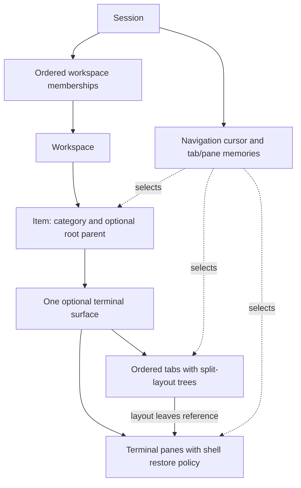
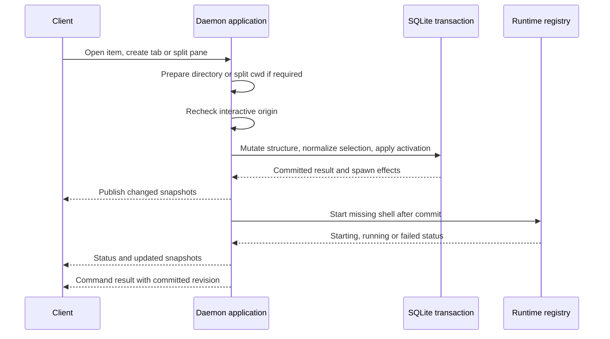

# Work and navigation

Architecture tour · **2 of 7** · Previous: [Overview](overview.md) · Next: [Directory catalog](directory-catalog.md)

Workspaces own work and terminal surfaces. Sessions own ordered workspace membership
and a durable navigation cursor into that work. Sharing a workspace does not copy
items or processes; sharing a session also shares its selected context. Local UI
focus is a separate responsibility described in [terminal interface](terminal-interface.md).

## Durable ownership

Categories are a fixed list projected for every workspace, not separate mutable
database records. Items are either generic, directory roots, or worktree children.
Generic items may have generic children; worktrees have directory parents. Ancestry
is limited to one root and one child level in the same workspace and category.
Every root or child can own its own surface.

A surface is created lazily. Opening an item for the first time creates a Main tab
and shell pane; subsequent opens reuse the surface. Merely selecting an item through
`session.navigate` does not create one. `session.openItem` and an item-level
`session.step` that moves selection ensure the destination surface. The CLI also
offers `surface.ensure` without changing session selection.

Tabs persist binary split trees whose leaves identify panes. `pane.split` replaces
one leaf, preserves ordering and equalizes direction-aware shares. Both server and
TUI use the exported `projectPaneLayout` to derive rectangles with one-cell dividers.
The shared layout describes terminal ownership; local viewport clipping and focus
remain UI concerns.

## Selection is a transaction, not a client preference

Each session cursor includes workspace, category, item, tab and pane IDs plus a
generation. Remembered tab-per-surface and pane-per-tab choices live in separate
session memory tables. Selecting a target resolves its complete ancestry; invalid
explicit targets fail instead of silently choosing something else. Relative steps
resolve from current daemon selection, do not wrap at the ends, and ignore local
filtering or tree expansion.

Structural commands also normalize every surviving session's navigation in the
same transaction. When a selected object becomes ineligible, normalization retains
a valid selection or chooses a neighboring survivor from the prior ordering.
Archiving a root makes its children ineligible without changing their archive bits.
The navigation generation changes when the selected cursor changes; changes to
remembered choices alone do not increment it.

For example, two clients on session A see the same selected tab. A third client on
session B can select another tab of the same item. All three still address the same
surface and panes. Removing a workspace from A removes A's membership and repairs
A's selection; it does not delete that workspace's items or stop their runtimes.
Likewise, deleting a session removes its memberships and memories, not shared work.

## From a command to a running pane

`applyCommand` is synchronous inside one SQLite transaction. Asynchronous directory
inspection and split-cwd lookup happen before it; the application rechecks the
connection origin after those awaits. Optional `navigationGeneration` or activation
generation rejects a command prepared against an obsolete selection. Activation
selects the exact returned pane within the structural transaction.

Process spawning follows the commit and is not rolled back with the catalog. A
spawn failure persists `failed` status and error text. The command response still
describes the committed resource; the CLI additionally reads resulting pane status
and exits with an error for a failed start. Response revision refers to the command
commit and can precede revisions caused by process status updates.

## Archive and client exposure

The backend and CLI can archive or restore any existing item. Archival hides it
from navigation and blocks new surfaces or splits, but emits no runtime stop effect
and does not erase retained output. The TUI archive action is narrower: its
navigator offers confirmation only for unavailable, unarchived directory/worktree
items. It does not expose the backend's general restore operation.

Directory items have identity and availability rules beyond this model; see
[directory catalog](directory-catalog.md). Process restart rules and cwd behavior
belong to [terminal processes](terminal-processes.md).

## Code References

- [Schema](../packages/server/src/persistence/database.ts): foreign keys, uniqueness,
  shared workspaces, navigation and surface records.
- [Command transaction](../packages/server/src/application/commands.ts)
  (`applyCommand`, `ensureSurface`): structural mutation, activation and spawn effects.
- [Navigation model](../packages/server/src/application/navigation.ts)
  (`selectNavigation`, `stepNavigation`, `normalizeNavigation`): selection rules.
- [Navigation persistence](../packages/server/src/application/navigation-store.ts):
  cursor and memory writes in the caller's transaction.
- [Items](../packages/server/src/application/items.ts): ancestry, archive and cwd rules.
- [TUI commands](../packages/tui/src/shell/commands.ts) (`availableCommands`,
  `executeCommand`): the narrower UI actions and follow-up activation.

Architecture tour · **2 of 7** · Previous: [Overview](overview.md) · Next: [Directory catalog](directory-catalog.md)
